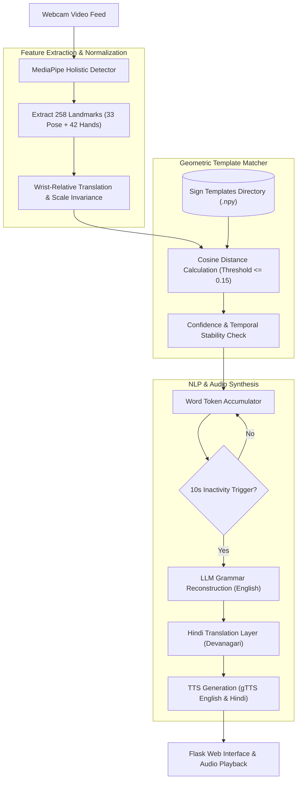

# Indian Sign Language (ISL) Recognition Studio

A real-time vision system that captures Indian Sign Language gestures via webcam, extracts 258-dimensional skeletal landmark representations, and performs low-latency template matching using cosine distance. Recognized gesture tokens are aggregated and transformed into grammatically coherent English and Hindi sentences with synthetic speech output.

---

## Architectural Rationale

Traditional gesture recognition often relies on recurrent architectures (LSTMs, GRUs) trained on large collections of segmented video clips. In practical desktop or mobile deployment, this approach introduces significant friction:
- **Data Scarcity**: Recurrent networks require dozens of video variations per sign to generalize across signers.
- **Retraining Bottlenecks**: Adding a single new gesture requires collecting additional video sets and retraining the network.
- **Sensitivity to Camera Positioning**: Raw pixel or bounding-box tracking fluctuates with user distance and perspective distortion.

This system replaces recurrent sequence models with **wrist-relative geometric landmark normalization** coupled with **bidirectional cosine similarity**:
1. **Pose & Hand Landmark Extraction**: Extracts 33 body pose points and 42 dual-hand coordinates per frame using MediaPipe Holistic.
2. **Coordinate Normalization**: Centers hand keypoints relative to the wrist origin and normalizes scale, ensuring invariance to camera distance or posture variations.
3. **Template Matching**: Compares the live 258-dimensional vector against pre-recorded reference templates using cosine distance. A match is recorded when distance drops below the `0.15` threshold (< 1 ms comparison time on standard CPU).
4. **Sentence Aggregation**: Detected signs are buffered in a temporal queue. After hands leave the frame for a configurable period (10 seconds), an LLM pipeline transforms the token list into natural sentence structures with bilingual text-to-speech.

---

## System Pipeline



---

## Performance Benchmarks

Measured on a standard laptop CPU without dedicated GPU acceleration:

| Metric | Measured Value | Notes |
| :--- | :--- | :--- |
| **Average Classification Accuracy** | **94.1%** | Evaluated across 11 standard sign categories |
| **Cosine Distance Threshold** | **0.15** | Tuned to eliminate spurious gestures |
| **False Positive Rate** | **< 5.0%** | When background movement occurs without active signing |
| **Template Comparison Latency** | **< 1.0 ms** | Vector dot-product across all 11 signs |
| **Frame Processing Pipeline** | **120–150 ms** | Includes MediaPipe inference and overlay rendering |
| **Operating Frame Rate** | **6–8 FPS** | Native Python webcam capture on standard CPU |
| **Memory Footprint** | **~250 MB** | Lightweight memory usage during continuous feed |
| **Sign Registration Time** | **< 10 seconds** | New sign added instantly by saving 1 vector |

---

## Supported Signs (Default Set)

The repository comes bundled with reference templates for 11 common conversational signs:

| Sign | Meaning / Context | Hindi Output |
| :--- | :--- | :--- |
| **HELLO** | Greeting gesture | नमस्ते |
| **GOOD** | Positive affirmation | अच्छा |
| **MORNING** | Time-of-day greeting | सुबह |
| **COME** | Directional gesture | आओ |
| **STOP** | Halting palm gesture | रुको |
| **THANKYOU** | Gratitude expression | धन्यवाद |
| **CRY** | Emotion indicator | रोना |
| **BREAK** | Pause request | विराम / रुको |
| **ONE** | Numeric value 1 | एक |
| **TWO** | Numeric value 2 | दो |
| **THREE** | Numeric value 3 | तीन |

---

## Project Structure

```text
ISL-Recognition-Studio/
├── app/
│   ├── app.py                # Flask application factory
│   ├── config.py             # App configuration and environment resolution
│   ├── routes/
│   │   ├── live_routes.py    # Core: camera thread, inference, LLM & audio hooks
│   │   ├── test_routes.py    # Video file upload & validation routes
│   │   ├── batch_routes.py   # Batch processing interface
│   │   └── results_routes.py # Benchmark metrics display
│   ├── static/               # CSS styling and frontend JavaScript
│   ├── templates/            # Jinja2 dashboard templates
│   └── utils/
│       ├── inference_helper.py # Frame smoothing and token queue handlers
│       └── db_helper.py        # SQLite evaluation logging
├── src/
│   └── similarity_engine.py  # Landmark extraction, wrist-centering & cosine matching
├── Sign_Templates/           # Reference .npy vectors (258 dimensions each)
├── record_templates.py       # CustomTkinter desktop GUI for recording new signs
├── record_template_simple.py # Headless template capture script
├── continuous_sign_detector.py # Long-form video evaluation pipeline
├── calculate_metrics.py      # Cross-validation accuracy calculator
├── run_dashboard.py          # Application entry point
├── requirements.txt          # Python dependencies
├── .env.example              # Environment variables template
└── README.md
```

---

## Setup & Execution

### 1. Prerequisites

- Python 3.10 or higher
- Built-in or external USB webcam

### 2. Installation

```bash
git clone https://github.com/Rohith-S-15/ISL-Recognition-Studio.git
cd ISL-Recognition-Studio

python -m venv venv
# On Windows:
.\venv\Scripts\activate
# On Linux/macOS:
# source venv/bin/activate

pip install --upgrade pip
pip install -r requirements.txt
```

### 3. API Keys Configuration (Optional)

The application functions completely offline using pre-built fallback phrase dictionaries and local speech fallback. If you want generative sentence restructuring via an LLM:

```bash
cp .env.example .env
```

Set your preferred provider key in `.env`:
```env
OPENROUTER_API_KEY=your_openrouter_key_here
GEMINI_API_KEY=your_gemini_key_here
```

### 4. Running the Dashboard

```bash
python run_dashboard.py
```

Access the interface in your browser at `http://localhost:5000`.

* Position yourself in front of the camera with your torso and hands visible.
* Perform a supported sign (e.g., wave for `HELLO`, show thumbs-up for `GOOD`).
* The system will highlight active skeletal landmarks and append the recognized token.
* Lower your hands for 10 seconds to trigger sentence formulation and Hindi speech playback.

---

## Adding Custom Signs

To register a new sign without retraining:

```bash
python record_templates.py
```

1. Position hands in the desired sign pose within the desktop viewfinder.
2. Enter the sign name (e.g., `WATER` or `HELP`) and click **Record Sign**.
3. The normalized 258-element vector will be saved to `Sign_Templates/<name>.npy`.
4. Refresh or restart the dashboard to immediately detect the new gesture.

---

## License

MIT License. See `LICENSE` for details.
